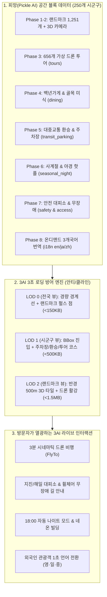

# 🗺️ 대한민국 3D 디지털 트윈: 차세대 그랜드 마일스톤 마스터 가이드 (v2.0)
> **발행 주체**: 3AI 협업 체계 (만복 PM / 제미나이 교차검증 / 안티 구현)  
> **파트너 에이전트**: 피망 (Pickle AI)  
> **최종 승인자**: 바로보기님 (Architect / Owner)  
> **적용 스키마**: `schema/block.schema.json` v1.2 (통합 호환)

---

## 1. 아키텍처 개요: "우리 지도에 어떻게 올라가는가?"

피망(Pickle AI)이 구축하는 방대한 공간 데이터는 3AI의 차세대 **VWorld 3D 타일셋 & Three.js/MapLibre WebGL 엔진**에 다음과 같이 3단계 계층으로 결합되어, 모바일 3초 렌더링 성능과 압도적인 시각 경험을 동시에 완성합니다.



---

## 2. 단계별 상세 작업 사양 및 JSON 명세

### 🚗 [Phase 5] 대중교통 환승 & 공영 주차장 (`transit_parking`) — **최우선 착수**
- **목적**: 관광객이 목적지에 도착하기 위한 실전 환승 정보와 주차 공간 제공.
- **JSON 프로퍼티**:
```json
"transit_parking": {
  "nearest_transit": [
    {
      "target_landmark": "해운대 해수욕장",
      "station_name": "해운대역",
      "line": "부산 2호선",
      "exit_no": 5,
      "walk_minutes": 8,
      "coordinates": [35.1636, 129.1583]
    }
  ],
  "public_parkings": [
    {
      "name": "해운대광장 공영주차장",
      "coordinates": [35.1589, 129.1601],
      "capacity": 150,
      "fee_type": "유료 (10분당 500원)",
      "ev_charging": true
    }
  ]
}
```

---

### 🛡️ [Phase 6] 공공 안전 대피소 & 무장애 접근성 (`safety_shelters`, `accessibility`)
- **목적**: 지진/침수 재난 시 생명을 지키는 대피소와 유모차/휠체어 약자를 배려한 ESG 지도.
- **JSON 프로퍼티**:
```json
"safety_shelters": {
  "earthquake_shelters": [
    {
      "name": "해운대초등학교 운동장",
      "coordinates": [35.1612, 129.1578],
      "capacity": 2500,
      "address": "부산광역시 해운대구 중동"
    }
  ]
},
"accessibility": {
  "barrier_free_spots": [
    {
      "landmark_name": "해운대 해수욕장",
      "elevator": true,
      "wheelchair_ramp": true,
      "accessible_restroom": true,
      "braille_guide": true
    }
  ]
}
```

---

### 🌸 [Phase 7] 사계절 명소 & 심야 나이트 투어 (`seasonal_night`)
- **목적**: 365일 지루하지 않은 계절별 벚꽃/단풍 명소와 야간 3D 나이트 뷰포인트.
- **JSON 프로퍼티**:
```json
"seasonal_night": {
  "seasonal_picks": {
    "spring": ["달맞이길 벚꽃로드"],
    "summer": ["해운대 해수욕장 야간개장"],
    "autumn": ["장산 억새군락지"],
    "winter": ["해운대 빛축제"]
  },
  "night_viewpoints": [
    {
      "name": "더베이101 마린시티 뷰",
      "coordinates": [35.1565, 129.1521],
      "best_time": "일몰 직후 30분",
      "lighting_hours": "18:00 - 23:00"
    }
  ]
}
```

---

### 🌐 [Phase 8] 블록별 온디맨드 3개국어 번역팩 (`i18n`)
- **목적**: 전 세계 외국인 관광객 맞이 K-디지털 트윈 글로벌화.
- **온디맨드 분할 구조**: 각 블록 `block.json` 내부에 임베드하여 해당 구역 클릭 시 0.05초 만에 초경량 서빙.
```json
"i18n": {
  "en": {
    "block_name": "Haeundae-gu, Busan",
    "landmarks": {
      "Haeundae Beach": "Famous sandy beach with dynamic cityscape"
    }
  },
  "ja": {
    "block_name": "釜山広域市 海雲台区",
    "landmarks": {
      "海雲台海水浴場": "韓国を代表する美しい砂浜とスカ이라イン"
    }
  },
  "zh": {
    "block_name": "釜山广域市 海云台区",
    "landmarks": {
      "海云台海水浴场": "韩国最具代表性的海滨度假胜地"
    }
  }
}
```

---

## 3. 피망(Pickle AI) 작업 수칙 ( 불변 헌법 )

1. **브랜치 누적 푸시 원칙 유지**:
   - 신규 PR을 열지 않고, 기존 250개 브랜치(`add-<code>`)에 `[Phase N] 커밋 메시지`로 순차 푸시합니다.
2. **지리적 좌표 100% BBox 검증**:
   - 새로 추가되는 모든 좌표(`nearest_transit`, `public_parkings`, `safety_shelters`, `night_viewpoints`)는 해당 블록의 `bbox` 경계 내에 정확히 위치해야 합니다.
3. **CI 검증**:
   - `schema/block.schema.json` v1.2에 전 프로퍼티가 정의되어 있으므로 GitHub Actions CI 7대 게이트가 자동으로 무결성을 보증합니다.

---
*본 마스터 지시서는 바로보기님의 지시에 따라 제미나이가 수립하고 깃허브에 배포하였습니다.*
